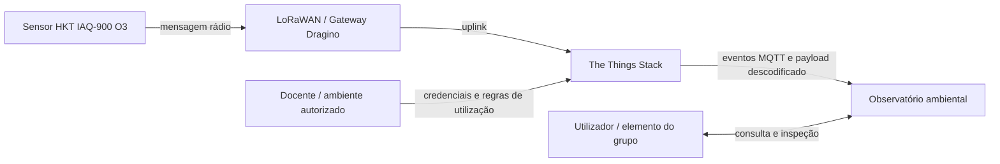
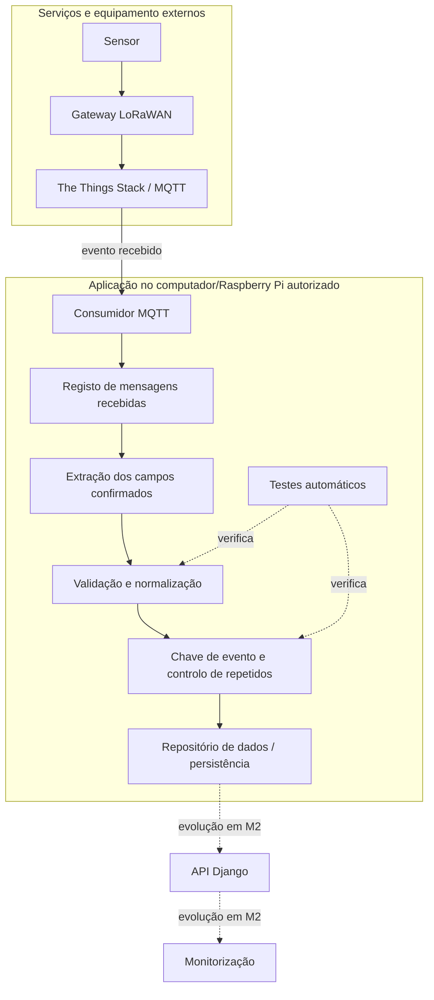

# Plano de trabalho para M1 — Aquisição e normalização

**Estado:** rascunho de acompanhamento elaborado a partir do enunciado MP01 e do estado visível da atividade GL02. Confirmar os detalhes do ambiente-base com o docente e não declarar como demonstrado o que ainda não foi executado.

## 0. Requisitos locais verificáveis para M1

Os identificadores desta tabela são auxiliares ao grupo e não substituem os IDs R01–R15 do MP01. Os critérios pressupõem a configuração e os campos efetivamente autorizados pelo docente.

| ID local | Requisito | Critério de aceitação proposto |
|---|---|---|
| F01 | Receber e registar mensagens | Um ensaio autorizado produz registos das mensagens recebidas, incluindo origem identificável e instante de receção; não expõe credenciais. |
| F02 | Normalizar observações | Cada campo utilizado tem tipo, unidade e regra documentados; valores fora do contrato são rejeitados com campo e motivo controlados. |
| F03 | Preservar ausência e proveniência | Campo ausente/valor nulo não se transforma em zero; a origem temporal e a proveniência real/sintética ficam explícitas. |
| F04 | Continuar após rejeição | Um lote delimitado que contenha uma mensagem inválida regista a rejeição e processa as mensagens válidas seguintes. |
| F05 | Evitar duplicados na aplicação | Reproduzir o mesmo identificador de evento não cria uma segunda observação aceite; dois eventos diferentes com valores iguais continuam distintos. |
| F06 | Tornar o ensaio reproduzível | Comandos, dados de teste, versão Git, resultados e limitações ficam registados e outro elemento consegue repetir o ensaio autorizado. |
| F07 | Proteger configuração | Credenciais são fornecidas fora do código versionado; a configuração de exemplo contém apenas nomes de variáveis e valores fictícios. |

## 1. Arquitetura proposta

Os diagramas descrevem a arquitetura pretendida, não uma afirmação de que todos os componentes já estão implementados. Os campos concretos do payload do sensor têm de ser confirmados no The Things Stack e na documentação do dispositivo autorizado.

### Diagrama de contexto

### Diagrama dos principais componentes

A representação da API Django e da monitorização é uma indicação da evolução do produto. O MP01 não exige Django, modelo digital ou contentores na entrega M1.

## 2. Situação observada no repositório fornecido

| Requisito MP01 | Estado nesta cópia GL02 | Próxima ação para M1 completo |
|---|---|---|
| R01 — Especificação e arquitetura | Parcial: existe contrato GL02 para quatro campos e este rascunho de arquitetura. | Definir o contrato real do evento recebido, critérios verificáveis e diagramas finais alinhados com a implementação. |
| R02 — Código modular | Parcial: `validacao.py` e `app.py` separam validação e leitura de JSONL sintético. | Separar consumidor MQTT, transformação, registo/persistência e apresentação; documentar decisões e erros. |
| R03 — Git e revisão | Existe um repositório GitHub público; a revisão independente não foi verificada nesta tarefa. | Confirmar ramo e commits, relacionar alteração com problema, obter revisão de outro elemento e identificar a versão entregue. |
| R04 — Aquisição MQTT | Não demonstrada pela atividade GL02. | Receber e guardar uma observação autorizada real; se houver impedimento, documentar e obter aprovação para dados alternativos. Não apresentar dados sintéticos como aquisição física. |
| R05 — Normalização | Parcial: são validados `quantity`, `unit`, `value` e `quality` no contrato sintético GL02. | Confirmar nomes, unidades, fatores de conversão e campos reais; preservar tempos e proveniência; distinguir ausência de zero. |
| R06 — Reprocessamento e idempotência | Não cumprido pela aplicação GL02: o lote repete intencionalmente a primeira observação e ambas são aceites. | Definir uma chave estável de evento e demonstrar que repetir a mensagem não cria nova observação válida; registar tentativas recebidas. |
| R12 — Testes | Parcial: os 14 testes da atividade GL02 passam na cópia de trabalho. | Acrescentar testes aos componentes reais de receção, registo, falhas e idempotência; guardar comandos e resultados da versão submetida. |
| R13 — Segredos | A atividade não configura serviços reais nem credenciais. | Usar variáveis de ambiente/configuração local, manter segredos fora do Git e confirmar que não aparecem nos logs ou documentação. |

## 3. Contrato de dados a confirmar antes de integrar o sensor

O contrato M1 deve documentar, pelo menos:

- identificador estável do dispositivo e identificador/chave do evento;
- grandeza, valor, unidade e qualidade;
- instante de receção e origem de cada marca temporal; `measured_at` fica ausente se o instante de medição não for conhecido;
- referência à mensagem de origem, proveniência real/sintética e modo de aquisição/recuperação;
- regra de normalização, conversões autorizadas e motivos de rejeição.

Não usar `indice_demo`/`u_demo` como se fossem campos reais do sensor. São exclusivos do exercício GL02. Não inventar grandezas nem deduzir campos pela designação comercial do dispositivo.

## 4. Testes e evidências a recolher

1. Mensagem válida e autorizada recebida, com identificação do dispositivo e relação entre payload e campos descodificados.
2. Valor ausente, valor inválido e unidade não admitida; a ausência não se converte em zero e a rejeição não interrompe as mensagens seguintes.
3. Repetição da mesma chave de evento; conservar o registo da receção, mas não acrescentar uma segunda observação válida.
4. Reiniciar o consumidor e repetir o ensaio no estado delimitado; documentar o que sobrevive ao reinício e eventuais limitações.
5. Registar comandos, resultados, limitações, identificador do commit e revisão independente.

## 5. Limites e pendências

- Esta atividade GL02 usa um lote JSONL sintético local; não representa receção MQTT nem valida o payload físico.
- A persistência e API Django são aprofundadas em M2; o modelo digital e a sua validação ficam para M3.
- O ensaio de revisão e integração Git do grupo, a configuração no ambiente autorizado, a aquisição física e a idempotência M1 continuam por demonstrar.
